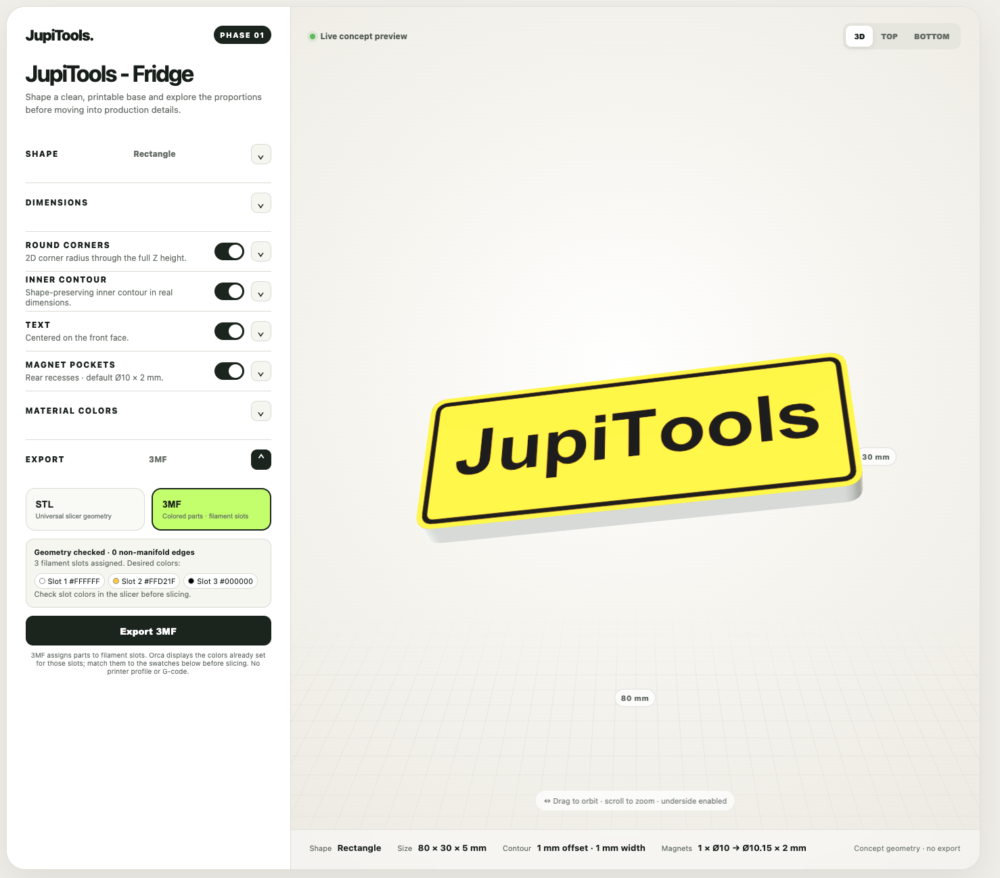
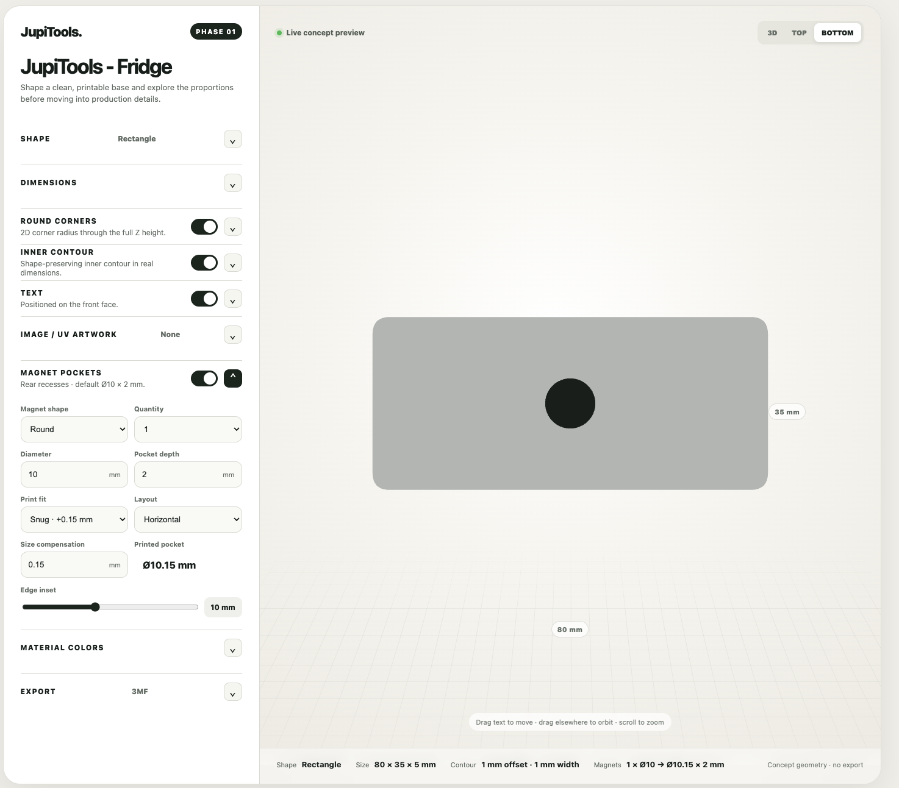

# JupiTools - Fridge

**[Open JupiTools - Fridge in your browser](https://jupishinn.github.io/JupiTools-Fridge/)** — no download or setup required. Design your magnet online and download STL, color 3MF, or print-size PNG directly from the app. To keep GitHub open, Command-click the link on Mac or Ctrl-click it on Windows/Linux.





Interactive prototype for designing 3D printable magnets. Choose a shape and dimensions, add a contour or text, place rear magnet pockets, and preview the result in 3D. You can also add PNG/JPEG artwork for a visual mockup or import an SVG logo to create colored 3D parts for 3MF export.

## SVG logos and color 3MF

1. Open **SVG logo / 3MF** and choose an SVG file. The app reads filled paths and can render many logos containing text, strokes, and transforms.
2. Set the logo size and position on the magnet. Choose a color from the paint bucket swatches or the color picker, then click a visible region of the logo to recolor it. Repeat for other regions.
3. Open **Export**, select **3MF**, and download the file. The front face, contour, text, and logo colors become separate printable parts. The app checks the geometry before exporting.

The 3MF assigns colored parts to filament slots. Match the slot colors to your filaments in the slicer before slicing. It does **not** include a printer profile or G-code. Very detailed SVG effects may be simplified to a limited set of flat print colors.

PNG/JPEG artwork is for on-screen preview and print-size PNG export for UV printing. It is not included as 3D geometry in STL or 3MF.

## Run locally (step by step)

You need [Git](https://git-scm.com/downloads) if you choose the clone method, and [Python 3](https://www.python.org/downloads/) to start the local web server. Keep an internet connection while using the app because its 3D libraries and optional fonts load from a CDN.

1. In Finder (Mac) or File Explorer (Windows), go to the **parent folder** where you want to keep JupiTools - Fridge, such as Documents. The next steps will create a `JupiTools-Fridge` folder inside it.
2. Open a command window in that parent folder:
   - **Mac:** Right-click the folder and choose **New Terminal at Folder** (if available). Alternatively, open Terminal, type `cd ` (including the space), drag the folder from Finder into Terminal, and press Enter.
   - **Windows:** Open the folder in File Explorer, click its **address bar** at the top, type `cmd`, and press Enter.
3. Open the [JupiTools - Fridge GitHub page](https://github.com/JupiShinn/JupiTools-Fridge). Click the green **Code** button, select **HTTPS**, and click the copy icon next to the repository URL. Then type `git clone ` in Terminal or Command Prompt, paste the copied URL, and press Enter. The complete command is:

   ```sh
   git clone https://github.com/JupiShinn/JupiTools-Fridge.git
   ```

   **No Git?** On the same GitHub page, click **Code → Download ZIP**. Extract the ZIP into your chosen parent folder. The extracted folder is usually named `JupiTools-Fridge-main`.
4. Open the project folder in your command window:
   - **Cloned with Git:** `cd JupiTools-Fridge`
   - **Downloaded ZIP:** `cd JupiTools-Fridge-main`
5. Start the local server. Leave this command window open while using the app:
   - **Mac:** `python3 -m http.server 8000`
   - **Windows:** `py -3 -m http.server 8000` (if `py` is unavailable, try `python -m http.server 8000`)
6. Open [http://localhost:8000/index.html](http://localhost:8000/index.html) in your browser. You should see the yellow magnet in the preview. To use the app again later, repeat steps 4–6; you do not need to clone or download it again.

If you see the controls but **no magnet**, make sure the command window is open in the project folder, `fonts/arial_ce_bold.typeface.json` is present, and your internet connection is working. If port 8000 is already in use, use port 8001 in the server command and open `http://localhost:8001/index.html` instead.

## Export file names

Exported files can use the magnet text automatically or an exact custom file name. Select the option in **Export** before downloading.

This is a Phase 01 prototype. Check geometry and slicer settings before printing.
